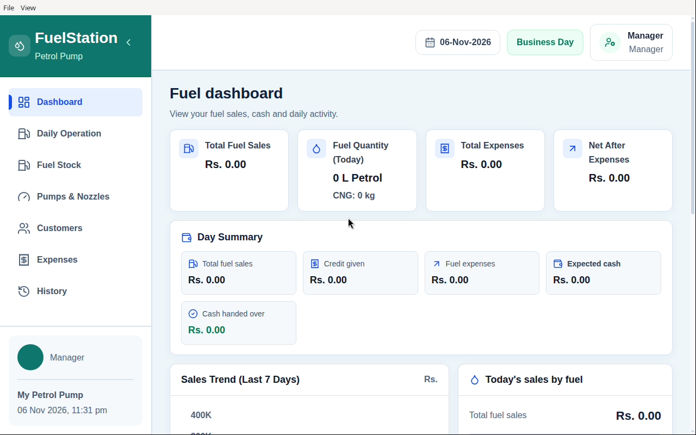
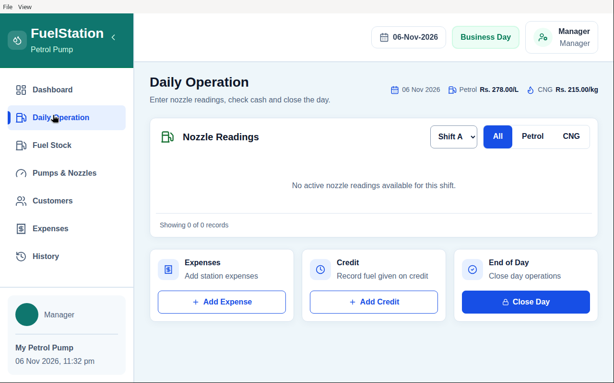
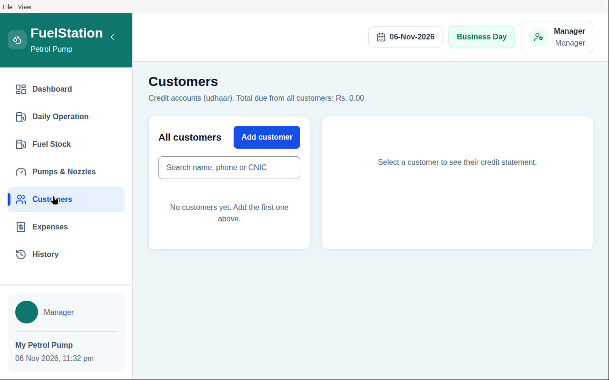

# FuelStation Manager

[](https://github.com/MubashirNoor7/fuel-station-manager/actions/workflows/ci.yml)
[](LICENSE)

A desktop app for running one petrol pump, built with Electron, React and
SQLite (Node's built-in `node:sqlite`). Everything is stored on the owner's
own computer; it opens straight to the dashboard and has no sign-in.

It replaces the paper register: nozzle meter readings, fuel stock, customer
credit (*udhaar*), daily expenses, and the end-of-day cash check.

> **Status:** early (v0.1.0). Single pump, single computer, single user.
> See [Known limitations](#known-limitations) before relying on it for real accounts.

## What it does

- **Daily nozzle readings** — enter opening and closing meter readings per
  nozzle and shift. The sale is calculated as
  (closing − opening) × rate, and a reading cannot be accepted twice.
- **Fuel stock** — record opening stock and fuel supplies. A reading is blocked
  when there is not enough fuel in stock for it.
- **Fuel rates** — petrol and CNG rates with a rate history. Changing the rate
  only affects new readings; readings already saved keep their old rate.
- **Customers and credit (udhaar)** — keep a customer list with balances, give
  credit, receive repayments, and see each customer's statement with a running
  balance. A repayment larger than the balance is rejected.
- **Expenses** — record daily expenses with categories, and reverse an entry
  with a reason when a mistake is made. Enter each expense once — entries from the Expenses page and from inside Daily Operation are added together for the day.
- **Dashboard** — the day's totals at a glance: fuel sold, sales amount,
  credit given, expenses and expected cash.
- **History** — past days with their totals. A day can be closed once its
  readings are complete; closing is blocked when the day's total credit is
  more than the day's total fuel sales. A closed day can be reopened with a
  reason to fix an entry.
- **Print and export** — print the daily sheet, print the history report, or
  export reports as CSV (opens in Excel; Urdu/Unicode names are kept).
- **Backup** — *File → Back up database…* (Ctrl+B) saves a consistent copy of
  all data to any folder, such as a USB drive.
- **Dates** — all dates use the Asia/Karachi timezone, so a day never flips at
  midnight UTC.

## Screenshots



*Dashboard — the daily totals at a glance. (Demo data.)*



*Daily Operation — enter nozzle readings per shift. (Demo data.)*



*Customers and credit — balances, credit given and repayments. (Demo data.)*

## Install (Windows)

Download `FuelStation-Manager-Setup-<version>.exe` from the
[Releases](https://github.com/MubashirNoor7/fuel-station-manager/releases)
page and run it. The installer is not code-signed, so Windows SmartScreen may
show a warning the first time.

## Run from source

Node.js 24 or later is required (the app uses `node:sqlite`).

```sh
npm install
npm run build    # type-check and build the frontend
npm start        # run the desktop app
npm run dev      # start the frontend dev server (port 3000)
```

To build the Windows installer yourself: `npm run dist` (output in `release/`).

## Backup and restore

- **Back up:** *File → Back up database…* and choose a location. Do this at
  least at the end of every working day and keep a copy off the computer.
- **Restore:** close the app, then replace `business.sqlite` inside the app's
  `business-data` folder (under Electron's `userData` directory, typically
  `%APPDATA%\FuelStation Manager` on Windows) with your backup, and delete
  `business.sqlite-wal` and `business.sqlite-shm` if they exist. Start the app.

Do not copy `business.sqlite` by hand while the app is running; recent entries
can still be in the `-wal` file. Use the backup command instead.

## Tests

```sh
npm run test:all   # calculations, day totals, store, readings, stock, dates, CSV and backup
```

The suites run against in-memory or temporary test databases and never touch
real data. Continuous integration runs the same commands on every push.

## Project layout

```
electron/   main process: window, menu, IPC, SQLite store (business-store.cjs),
            reading ledger, CSV and backup helpers
src/        React interface (screens in components/, pure calculations in logic/)
tests/      node:test suites for the store, calculations, dates and exports
```

All money is stored as whole paisas (integers) in SQLite; the interface only
formats it for display.

## Known limitations

- **No sign-in and no encryption.** Anyone who can open the app or read the
  database file can see and change everything. The database is a plain SQLite
  file. Protect the computer itself (Windows account password, disk encryption).
- **One computer, one user.** There is no sync and no multi-user mode.
- **One pump.** Multiple stations are not supported.
- **Pakistan-specific defaults:** Asia/Karachi dates, Rs. currency, petrol and CNG.
- **Backups are manual.** The app does not back up by itself yet.

## Roadmap

Plans, not features that exist today:

- Optional PIN lock on startup
- Scheduled automatic local backups
- Restore from the UI
- Cloud sync / owner mobile view (only after the local app is solid)

## Contributing

Bug reports and pull requests are welcome. See [CONTRIBUTING.md](CONTRIBUTING.md).
Security problems: see [SECURITY.md](SECURITY.md).

## License

MIT — see [LICENSE](LICENSE).
